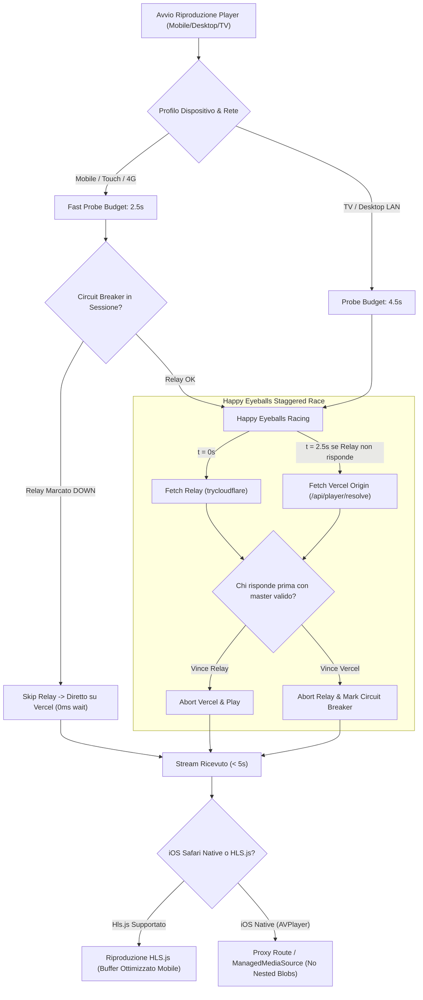

# Blueprint Ingegneristico: Mobile Video Player Resilience & Zero-Hang Architecture

## 1. Executive Summary & Diagnostica

### 1.1 Il Problema Rilevato
Da smartphone, l'avvio di episodi (es. *The Diplomat* S01E01) si interrompeva sistematicamente con l'errore:
> *"Il player non si è caricato in tempo"* (Toast rosso a 55 secondi).

### 1.2 La Dimostrazione Matematica del Fallimento
Nel flusso precedente di `lib/player-resolve.ts` e `components/vixsrc-embed-player.tsx`:

```text
[t = 0s]  Componente Player montato. Si avvia LOAD_TIMEOUT_MS = 55s.
[t = 1s]  GET /api/player/relay restituisce l'URL del tunnel:
          https://only-crimes-provider-throws.trycloudflare.com
[t = 1s]  attemptResolve(relay, attempts = 2, timeoutMs = 35s)
          Tentativo 1 al Relay: la rete cellulare o il tunnel Quick Cloudflare
          rimangono appesi a livello TCP.
[t = 36s] Scade timeoutMs Tentativo 1 (35s).
[t = 36s] Tentativo 2 al Relay: nuova attesa su socket appeso.
[t = 55s] SCATTA LOAD_TIMEOUT_MS (55s) -> fail(false, "Il player non si è caricato in tempo").
          Il player viene distrutto e smontato.
[t = 71s] Il client avrebbe provato il fallback su Vercel, ma è troppo tardi (già morto a t = 55s).
```

### 1.3 Matrice dei Vincoli
| Ambiente | Connessione | Comportamento Precedente | Esito |
| :--- | :--- | :--- | :--- |
| **Smart TV (webOS)** | Wi-Fi / LAN Casa | Relay sulla stessa LAN / fibra veloce | **Funziona** |
| **PC Desktop** | Wi-Fi / Ethernet | Chrome / Hls.js con estensioni | **Funziona** |
| **Mobile (Android/iOS)** | Rete Dati 4G/5G | Carrier CGNAT / Cloudflare Hang / AVPlayer Blob | **FALLISCE (Timeout 55s)** |

---

## 2. Architettura della Soluzione (I 4 Pilastri Ingegneristici)



---

### Pilastro 1: RFC 8305 "Happy Eyeballs" Staggered Race (Zero-Wait Fallback)

Invece di una sequenza a cascata bloccante (prima Relay per 70s, poi Vercel):
1. **Staggered Launch (Lancio Sfalsato)**:
   - Al tempo $t = 0$: si invia la richiesta al Relay (se disponibile).
   - Viene allocato un **Probe Budget** rigido:
     - **Mobile (Cellulare/Touch):** **2.5 secondi**
     - **Desktop / TV:** **4.5 secondi**
2. **Attivazione Parallela di Vercel**:
   - Se entro il Probe Budget il Relay non ha ancora risposto con uno status 200 e il payload completo, **il client NON aspetta**: lancia immediatamente in parallelo la richiesta a Vercel `/api/player/resolve`.
3. **Corsa con Abort Automatico**:
   - Entrambe le richieste condividono una logica di mutua esclusione con `AbortController`.
   - Il primo canale che fornisce una master playlist valida **vince la corsa**.
   - Il canale perdente viene immediatamente interrotto via `.abort()`, rilasciando socket e risorse.
4. **Risultato prestazionale**:
   - Se il Relay risponde veloce (es. TV a casa): vince il Relay in 1.2s.
   - Se il Relay è appeso (es. telefono su 4G): scattano i 2.5s, Vercel risponde in ~3.5s ➔ **il video parte in 6s totali, ben 49 secondi prima del timeout di guardia!**

---

### Pilastro 2: Session-Level Circuit Breaker (Memoria del Fallimento)

Quando un utente guarda una serie TV da telefono, non deve subire il ritardo del relay per ogni singolo episodio della sessione.

1. **Stato del Circuito**:
   - Nel browser del client viene gestito un flag in `sessionStorage`:
     `vixsrc_relay_circuit: { state: "OPEN" | "CLOSED", failedAt: timestamp, failCount: number }`
2. **Regola di Apertura (Trip)**:
   - Se una richiesta al Relay va in timeout o errore di rete, il circuito passa a `OPEN` per **15 minuti**.
3. **Comportamento a Circuito Aperto**:
   - Per tutti i successivi cambi episodio o aperture player nella sessione, il Relay viene **completamente saltato** (0 ms di overhead) e la richiesta va diretta al backend Vercel.
4. **Half-Open Recovery**:
   - Trascorsi 15 minuti, il sistema consente una singola richiesta "sonda" al Relay per verificare se la connettività è stata ripristinata.

---

### Pilastro 3: TTL e Health Check nel Database Supabase (`vixsrc_home_relay`)

La tabella `vixsrc_home_relay` memorizza l'URL con `updated_at`.

1. **Scadenza dell'Annuncio (TTL di 5 minuti)**:
   - Lo script `announce.py` su Zima invia un heartbeat ogni 60 secondi aggiornando `updated_at = now()`.
   - In `lib/db/vixsrc-relay.ts`, la query considera valido il relay **SOLO SE**:
     ```sql
     select url from vixsrc_home_relay 
     where id = 1 and updated_at > (now() - interval '5 minutes');
     ```
2. **Vantaggio**:
   - Se la macchina di casa è spenta, la connessione Wi-Fi casalinga cade o il processo docker del relay si arresta, `/api/player/relay` restituisce immediatamente `url: null`.
   - Nessun client (né TV né telefono) sprecherà tempo a provare un tunnel morto.

---

### Pilastro 4: Risoluzione Compatibilità Mobile (iOS Safari & Autoplay Gate)

#### A. Il problema dei Blob annidati su iOS Safari
* `Hls.isSupported()` su iPhone Safari è `false` (usa `AVPlayer` di sistema).
* `createVixsrcBrowserSource` crea una master playlist `.m3u8` che referenzia altre sub-playlist `blob:http://...`.
* Il demone di sistema `mediaserverd` di iOS è isolato dal WebKit sandbox e non riesce a risolvere blob URL annidati.
* **Soluzione Architetturale per iOS**:
  1. **iOS 17.1+**: abilitare `ManagedMediaSource` su Hls.js affinché `Hls.isSupported()` sia `true` anche su iOS, unificando il motore di riproduzione con quello desktop.
  2. **Fallback iOS Legacy**: se il motore rimane `AVPlayer` nativo, le sotto-tracce vengono instradate attraverso l'endpoint manifest proxy `/api/player/hls?u=...` invece di blob annidati non risolvibili.

#### B. Autoplay Gesture Gate
* Su mobile, i browser bloccano l'avvio non muto se non c'è stata una gesture esplicita.
* Se `video.play()` viene respinto dalla policy del browser mobile, il componente mostra all'istante un'icona **"Tocca per avviare"** chiara e reattiva, azzerando il timer di timeout e impedendo la schermata di errore generica.
