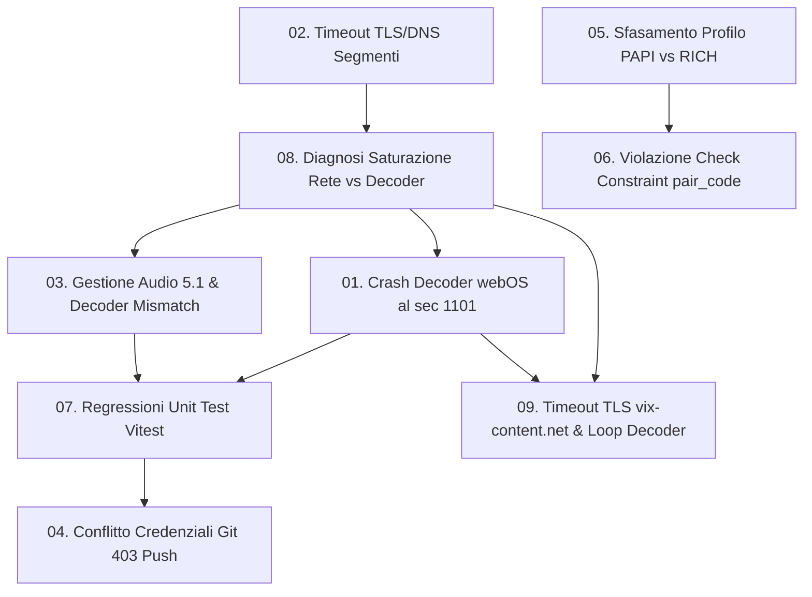

# Archivio Errori e Risoluzioni Tecniche

Questa cartella raccoglie i report tecnici dettagliati di tutti gli errori e le anomalie riscontrate, analizzate e risolte durante la sessione di lavoro.

Ogni documento segue lo standard rigoroso:
- **Descrizione del problema**
- **Cosa lo causava**
- **Cosa è stato fatto per risolverlo**
- **Eventuali errori successivi generati o correlati**

---

## Indice dei Report

| File | Titolo / Ambito | Categoria | Stato |
| :--- | :--- | :--- | :--- |
| [01-smart-tv-media-err-decode-1101.md](file:///c:/Users/matti/Documents/TheHustlePlace/doc/errore/01-smart-tv-media-err-decode-1101.md) | Crash Riproduzione Smart TV webOS al Secondo 1101 (`MEDIA_ERR_DECODE`) | Hardware / Video Decoder | Risolto |
| [02-tv-dns-segmenti-vixsrc-tls.md](file:///c:/Users/matti/Documents/TheHustlePlace/doc/errore/02-tv-dns-segmenti-vixsrc-tls.md) | Blocco Download Segmenti HLS Esterni su Smart TV e Timeout TLS/DNS | Network / Relay | Risolto |
| [03-audio-multicanale-mismatch-decoder.md](file:///c:/Users/matti/Documents/TheHustlePlace/doc/errore/03-audio-multicanale-mismatch-decoder.md) | Selezione Euristica Traccia Audio e Mismatch Multicanale 5.1 | Audio / Hls.js | Risolto |
| [04-git-remote-push-403-forbidden.md](file:///c:/Users/matti/Documents/TheHustlePlace/doc/errore/04-git-remote-push-403-forbidden.md) | Fallimento Git Push con Errore 403 Forbidden su Remote `thefplace` | Auth / Version Control | Risolto |
| [05-binding-profilo-papi-rich-codici.md](file:///c:/Users/matti/Documents/TheHustlePlace/doc/errore/05-binding-profilo-papi-rich-codici.md) | Sfasamento Profilo PAPI vs RICH (Bug di Focus/Binding della UI del Codice) | Logic / Database State | Risolto |
| [06-db-constraint-pair-code-format.md](file:///c:/Users/matti/Documents/TheHustlePlace/doc/errore/06-db-constraint-pair-code-format.md) | Violazione Check Constraint Database su `pair_code` (`PostgresError 23514`) | Database Constraints | Risolto |
| [07-unit-tests-regression-vitest.md](file:///c:/Users/matti/Documents/TheHustlePlace/doc/errore/07-unit-tests-regression-vitest.md) | Regressioni Unit Test Vitest su `tv-os.html` e `hls-config.ts` | Test Suite / TypeScript | Risolto |
| [08-saturazione-rete-vs-decoder-e-kit-diagnosi.md](file:///c:/Users/matti/Documents/TheHustlePlace/doc/errore/08-saturazione-rete-vs-decoder-e-kit-diagnosi.md) | Diagnosi Saturazione di Rete vs Stallo Decoder e Kit Intelligente di Rilevamento | Network Telemetry / Error Handling | Risolto |
| [09-cdn-vix-content-tls-timeout-e-decoder-loop.md](file:///c:/Users/matti/Documents/TheHustlePlace/doc/errore/09-cdn-vix-content-tls-timeout-e-decoder-loop.md) | Timeout TLS su `vix-content.net`, Token Relay Diretto e Nudge Decoder | Network / Hardware Decoder | Risolto |

---

## Mappa delle Relazioni Causali tra Errori

